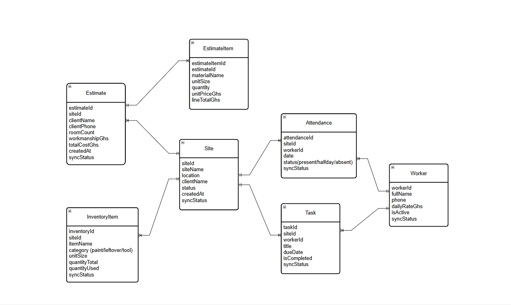
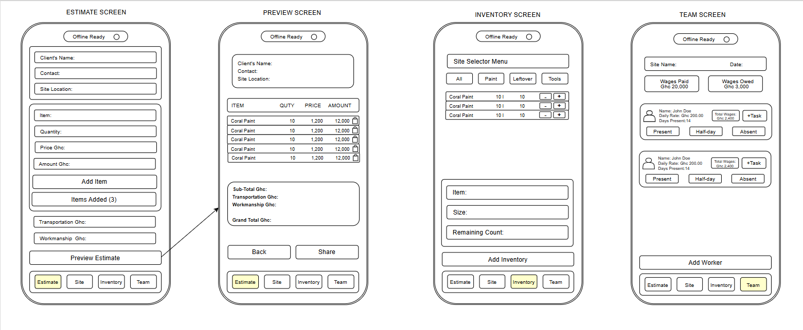

# Phase 3: Database Design, Schema & Mobile Wireframes — PaintUp

**Project Name:** PaintUp  
**Document Version:** 1.1 (Synced with Final 5-Screen Mobile Wireframes)  
**Status:** Complete  
**Storage Engine:** Browser `IndexedDB` via `Dexie.js`  
**Traceability:** Derived from `docs/02-requirements/requirements-spec.md` & Phase 3 Wireframes

---

## 1. Offline-First Data Architecture Decisions

To guarantee 100% offline reliability on active Ghanaian construction sites while remaining ready for future cloud synchronization, PaintUp enforces four core database design rules:

1. **Client-Generated UUID Primary Keys (`crypto.randomUUID()`):** Instead of sequential auto-increment integers (`1, 2, 3`), every record uses a globally unique UUID string. This prevents Primary Key collisions when records are created offline across multiple devices.
2. **Third Normal Form (`3NF`) Separation:** Repeating line items (such as multiple paint buckets, rollers, and primers on one quote) are normalized into a dedicated `EstimateItem` child table rather than stored as unstructured arrays.
3. **Zero Derived Storage for Wages:** Cumulative worker earnings (`GHS`) are computed dynamically at read time (`worker.dailyRateGhs × attendance.dayValue`) and grouped by `attendance.isPaid` (`Wages Paid` vs. `Wages Owed`), eliminating data-sync anomalies.
4. **Sync State Tracking (`syncStatus`):** Every top-level entity tracks its synchronization state (`'pending' | 'synced'`) so a background worker can safely upload offline changes once internet connectivity returns.

---

## 2. Entity-Relationship Diagram (ERD)



> *Note: Source diagram maintained in `draw.io` using Crow's Foot notation (`||` = One, `<` = Many).*

### Cardinality Summary
- **`Site (1) ────< (N) Attendance`:** One site tracks many daily apprentice attendance records.
- **`Worker (1) ────< (N) Attendance`:** One worker accumulates many daily attendance logs across sites.
- **`Site (1) ────< (N) Task`:** One site has many assigned painting tasks.
- **`Worker (1) ────< (N) Task`:** One worker can be assigned many site tasks.
- **`Site (1) ────< (N) InventoryItem`:** One site tracks many paint buckets, leftover mixes, and tools.
- **`Site (1) ────< (N) Estimate`:** One site can have one or more associated material quotes *(nullable for standalone quick quotes)*.
- **`Estimate (1) ────< (N) EstimateItem`:** One material quote breaks down into multiple itemized paint and accessory rows.

---

## 3. Data Dictionary (Normalized Entities)

### 3.1 `Site` (Dexie Store: `sites`)
Represents an active or completed residential/commercial painting project.

| Attribute | Key | Data Type | Description & Constraints |
| :--- | :--- | :--- | :--- |
| `siteId` | **PK** | `string (UUID)` | Unique site identifier |
| `siteName` | — | `string` | Project title (e.g., *"3 Bedroom Apartment"*, *"Studio Apartment"*) |
| `location` | — | `string` | Neighborhood or landmark in Ghana (e.g., *"Nima, Accra"*) |
| `clientName` | — | `string` | Property owner or contractor name |
| `status` | — | `string` | `'in_progress'` \| `'completed'` \| `'paused'` |
| `createdAt` | — | `string (ISO)` | Timestamp of site creation |
| `syncStatus` | — | `string` | `'pending'` \| `'synced'` |

### 3.2 `Worker` (Dexie Store: `workers`)
Represents an apprentice ("boy") or casual painter managed by a Master Painter.

| Attribute | Key | Data Type | Description & Constraints |
| :--- | :--- | :--- | :--- |
| `workerId` | **PK** | `string (UUID)` | Unique worker identifier |
| `fullName` | — | `string` | Worker's full name or site nickname |
| `phone` | — | `string` | Ghanaian mobile number (`024...`, `055...`, etc.) |
| `dailyRateGhs` | — | `number` | Agreed daily wage rate in Ghana Cedis (`GHS`) |
| `isActive` | — | `boolean` | `true` if currently active on the team roster |
| `syncStatus` | — | `string` | `'pending'` \| `'synced'` |

### 3.3 `Attendance` (Dexie Store: `attendance`)
Junction entity recording daily worker presence on a specific site. Enforces a unique compound index on `[workerId+date]` to prevent duplicate wage entries.

| Attribute | Key | Data Type | Description & Constraints |
| :--- | :--- | :--- | :--- |
| `attendanceId` | **PK** | `string (UUID)` | Unique attendance log identifier |
| `siteId` | **FK** | `string (UUID)` | References `Site.siteId` |
| `workerId` | **FK** | `string (UUID)` | References `Worker.workerId` |
| `date` | — | `string (YYYY-MM-DD)` | Calendar date of work |
| `status` | — | `string` | `'present'` \| `'half-day'` \| `'absent'` |
| `dayValue` | — | `number` | Multiplier for wage calculation (`1.0`, `0.5`, or `0.0`) |
| `isPaid` | — | `boolean` | `false` = counted under **Wages Owed**; `true` = counted under **Wages Paid** |
| `syncStatus` | — | `string` | `'pending'` \| `'synced'` |

### 3.4 `Task` (Dexie Store: `tasks`)
Tracks daily site assignments delegated to apprentices (`+Task`).

| Attribute | Key | Data Type | Description & Constraints |
| :--- | :--- | :--- | :--- |
| `taskId` | **PK** | `string (UUID)` | Unique task identifier |
| `siteId` | **FK** | `string (UUID)` | References `Site.siteId` |
| `workerId` | **FK** | `string (UUID)` | References `Worker.workerId` |
| `title` | — | `string` | Task summary (e.g., *"Scrape and prime master bedroom"*) |
| `dueDate` | — | `string (YYYY-MM-DD)` | Target completion date |
| `isCompleted` | — | `boolean` | Completion toggle state |
| `syncStatus` | — | `string` | `'pending'` \| `'synced'` |

### 3.5 `InventoryItem` (Dexie Store: `inventoryItems`)
Tracks `18L`/`20L` paint buckets, leftover tinted mixes, and tools per site.

| Attribute | Key | Data Type | Description & Constraints |
| :--- | :--- | :--- | :--- |
| `inventoryId` | **PK** | `string (UUID)` | Unique inventory item identifier |
| `siteId` | **FK** | `string (UUID)` | References `Site.siteId` |
| `itemName` | — | `string` | Product or tool name (e.g., *"Coral Paint"*) |
| `category` | — | `string` | `'paint'` \| `'leftover'` \| `'tool'` |
| `unitSize` | — | `string` | Unit measure (e.g., `'20L bucket'`, `'4L gallon'`, `'piece'`) |
| `quantityTotal` | — | `number` | Total units brought to site |
| `quantityRemaining` | — | `number` | Current remaining stock updated via `-` / `+` counters |
| `syncStatus` | — | `string` | `'pending'` \| `'synced'` |

### 3.6 `Estimate` (Dexie Store: `estimates`)
Stores header metadata, logistics, workmanship, and totals for instant client quotes generated on site.

| Attribute | Key | Data Type | Description & Constraints |
| :--- | :--- | :--- | :--- |
| `estimateId` | **PK** | `string (UUID)` | Unique quote identifier |
| `siteId` | **FK** | `string (UUID) \| null` | Optional reference to `Site.siteId` |
| `clientName` | — | `string` | Prospective client or landlord name |
| `clientPhone` | — | `string` | Client WhatsApp contact number |
| `clientLocation` | — | `string` | Job site location (e.g., *"Accra Newtown"*) |
| `subTotalGhs` | — | `number` | Sum of all `EstimateItem.lineTotalGhs` rows |
| `transportGhs` | — | `number` | Logistics & transportation fee in `GHS` |
| `workmanshipGhs` | — | `number` | Labor/workmanship fee in `GHS` |
| `totalCostGhs` | — | `number` | Grand total (`subTotalGhs + transportGhs + workmanshipGhs`) |
| `createdAt` | — | `string (ISO)` | Quote generation timestamp |
| `syncStatus` | — | `string` | `'pending'` \| `'synced'` |

### 3.7 `EstimateItem` (Dexie Store: `estimateItems`)
Child line items belonging to a parent `Estimate`.

| Attribute | Key | Data Type | Description & Constraints |
| :--- | :--- | :--- | :--- |
| `estimateItemId` | **PK** | `string (UUID)` | Unique line-item identifier |
| `estimateId` | **FK** | `string (UUID)` | References `Estimate.estimateId` |
| `materialName` | — | `string` | Material description (e.g., *"Coral Paint"*) |
| `quantity` | — | `number` | Number of units required |
| `unitPriceGhs` | — | `number` | Current market price per unit in `GHS` |
| `lineTotalGhs` | — | `number` | Calculated subtotal (`quantity × unitPriceGhs`) |

---

## 4. `Dexie.js` Implementation Schema (`src/db/db.js`)

Because `IndexedDB` stores schemaless JavaScript objects, only Primary Keys, Foreign Keys, and queryable/sortable fields are indexed below (adding `isPaid` on `attendance` for fast `Wages Paid` vs. `Wages Owed` queries):

```javascript
import Dexie from 'dexie';

export const db = new Dexie('PaintUpDB');

db.version(1).stores({
  sites: 'siteId, siteName, status, createdAt, syncStatus',
  workers: 'workerId, fullName, isActive, syncStatus',
  attendance: 'attendanceId, siteId, workerId, &[workerId+date], status, isPaid, syncStatus',
  tasks: 'taskId, siteId, workerId, isCompleted, syncStatus',
  inventoryItems: 'inventoryId, siteId, itemName, category, syncStatus',
  estimates: 'estimateId, siteId, createdAt, syncStatus',
  estimateItems: 'estimateItemId, estimateId, materialName',
});

export default db;
```

---

## 5. Low-Fidelity Mobile Wireframes (Thumb-Zone UI Blueprint)

### Core Workflow Screens (`Estimate`, `Preview`, `Inventory`, `Team`)


### Project Management Screen (`Site`)


---

## 6. Phase 3 Sign-Off & Next Step

- **Verification:** Database normalized to `3NF`, aligned with all 5 mobile wireframes (`transportGhs`, `clientLocation`, `isPaid`, `quantityRemaining`), and ready for local-first persistence.
- **Next Deliverable:** **Phase 4 — Scaffolding the Vite + React + Tailwind PWA & Building Sprint 1 (`Instant Estimator` + `Quote Preview` + `WhatsApp Export`)**.
